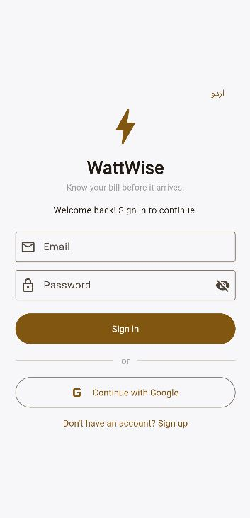
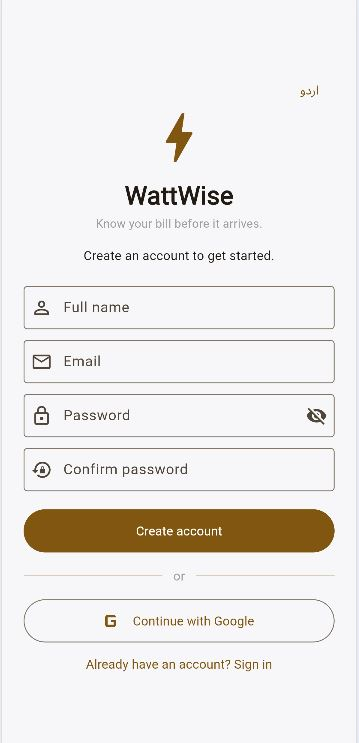
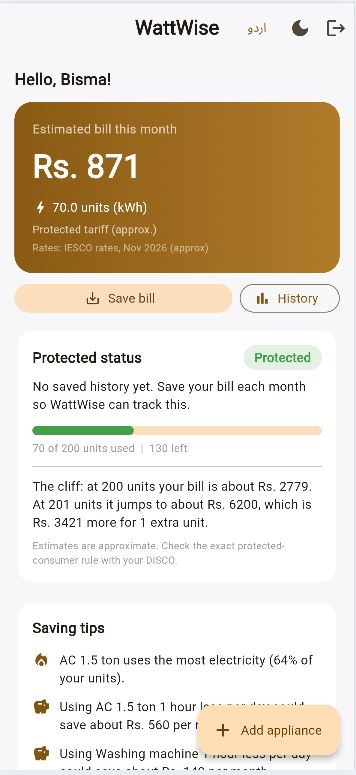
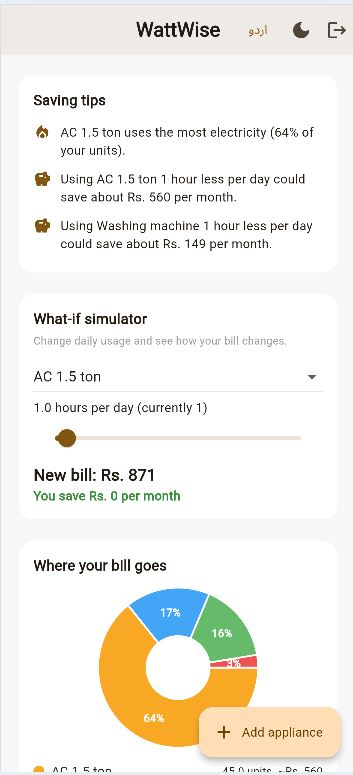
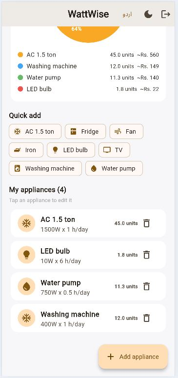
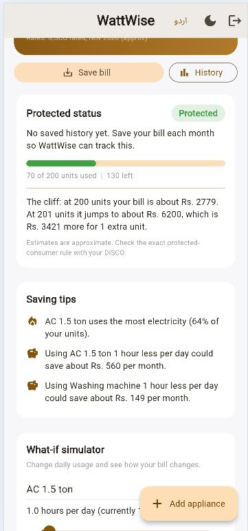
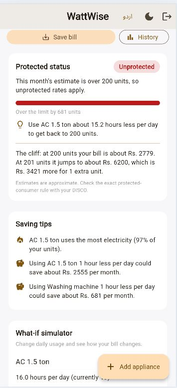
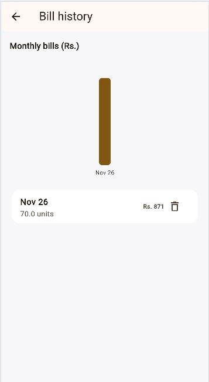
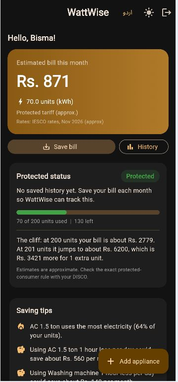
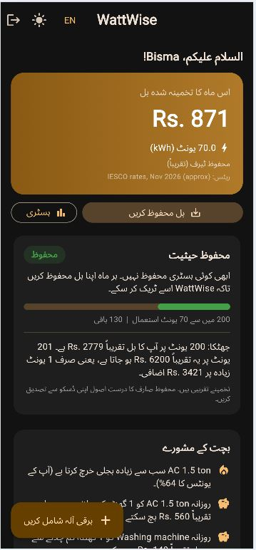

# WattWise ⚡

**Know your electricity bill before it arrives.**

A Flutter + Firebase app that estimates a household's monthly electricity bill in Pakistan from the appliances you use, shows where the money goes, and warns you before you cross the 200-unit "protected" limit.

**Live demo:** https://bijli-hisaab-ed666.web.app

## Screenshots

| Login | Sign up | Home |
|---|---|---|
|  |  |  |

| Home (2) | Home (3) | Home (4) |
|---|---|---|
|  |  |  |

| Protected | Unprotected | History |
|---|---|---|
|  |  |  |

| Dark mode | Urdu (RTL) |
|---|---|
|  |  |

## Features

- **Auth:** email/password sign up (name, confirm password) and Google sign-in
- **Appliances:** add, edit and delete, with one-tap presets (AC, fridge, fan, iron...)
- **Bill estimate:** slab-based calculation (protected / unprotected tariff), FC surcharge and GST
- **Protected status tracker:** checks your last 6 saved months, shows how many units are left before the limit, and a "cliff" simulator (bill at 200 units vs 201 units)
- **Saving tips:** top consumer, "1 hour less per day saves Rs. X", slab-limit alerts
- **Breakdown chart:** each appliance's share of units and bill
- **What-if simulator:** change an appliance's daily hours and see the new bill live
- **Monthly history:** save each month's bill, bar chart and month-over-month change
- **Live tariff updates:** rates live in Firestore and apply in real time, no app update needed
- **English / Urdu** (full RTL) and **dark / light** mode, both remembered
- **Data isolation:** Firestore security rules so each user can only access their own data

## Tech stack

- Flutter (Dart), Material 3, Provider
- Firebase Authentication (email/password, Google)
- Cloud Firestore (per-user data, remote tariff config)
- Firebase Hosting
- fl_chart, shared_preferences

## Architecture

```text
lib/
├── config/      tariff_config       (defaults, overwritten from Firestore)
├── models/      appliance, slab, bill_record
├── providers/   appliance_provider  (Firestore stream per user)
├── services/    auth, bill_calculator, tariff_service, history_service,
│                protected_status_service, theme_controller, language_controller
├── screens/     login, home, history
├── widgets/     tips, breakdown, what-if, protected card, history buttons
└── utils/       tips_engine, strings (EN/UR translations)
```

## Firestore structure

```text
users/{uid}/appliances/{id}   name, watts, hoursPerDay, daysPerMonth
users/{uid}/bills/{yyyy-MM}   units, total
config/tariff                 json (slabs, GST, FC surcharge, window, note)
```

Security rules: a user can read and write only `users/{their uid}/**`; `config/**` is read-only for signed-in users.

## Run locally

1. Install Flutter and the FlutterFire CLI.
2. Create a Firebase project, enable Email/Password and Google sign-in, and create Firestore.
3. Run `flutterfire configure` (generates `lib/firebase_options.dart`).
4. Create `config/tariff` in Firestore with a string field `json`:

```json
{
  "protectedLimit": 200,
  "protectedWindowMonths": 6,
  "gstRate": 0.18,
  "fcSurchargePerUnit": 0.43,
  "fixedCharge": 0,
  "note": "IESCO rates (approx)",
  "protectedSlabs": [
    {"from": 0, "to": 100, "rate": 10.54},
    {"from": 100, "to": 200, "rate": 13.01}
  ],
  "unprotectedSlabs": [
    {"from": 0, "to": 100, "rate": 22.44},
    {"from": 100, "to": 200, "rate": 28.91},
    {"from": 200, "to": 300, "rate": 33.10},
    {"from": 300, "to": 700, "rate": 33.10},
    {"from": 700, "to": null, "rate": 47.69}
  ]
}
```

5. Run:

```bash
flutter pub get
flutter run -d chrome
```

## Deploy

```bash
flutter build web --release
firebase deploy --only hosting
```

## Disclaimer

Estimates are approximate. Real bills include FCA/QTA adjustments and other charges that vary by month and DISCO, and the exact protected-consumer rule should be verified with your DISCO. Rates in this repo are examples and should be checked against your own bill.

## Roadmap

- Calibrate rates against real IESCO bills
- Unit tests for the bill calculator and protected-status rules
- Android build with Google sign-in
- Multi-DISCO support

## Author

**Bisma Maqbool**

BS Software Engineering, HITEC University Taxila

GitHub: [@BismaMaqbool](https://github.com/BismaMaqbool)